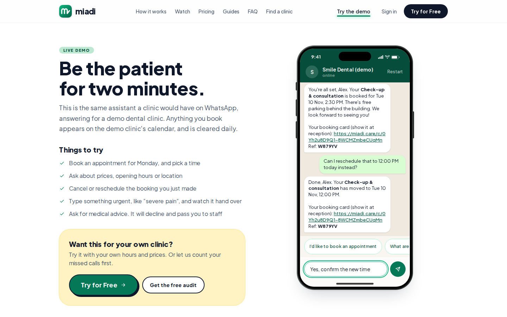
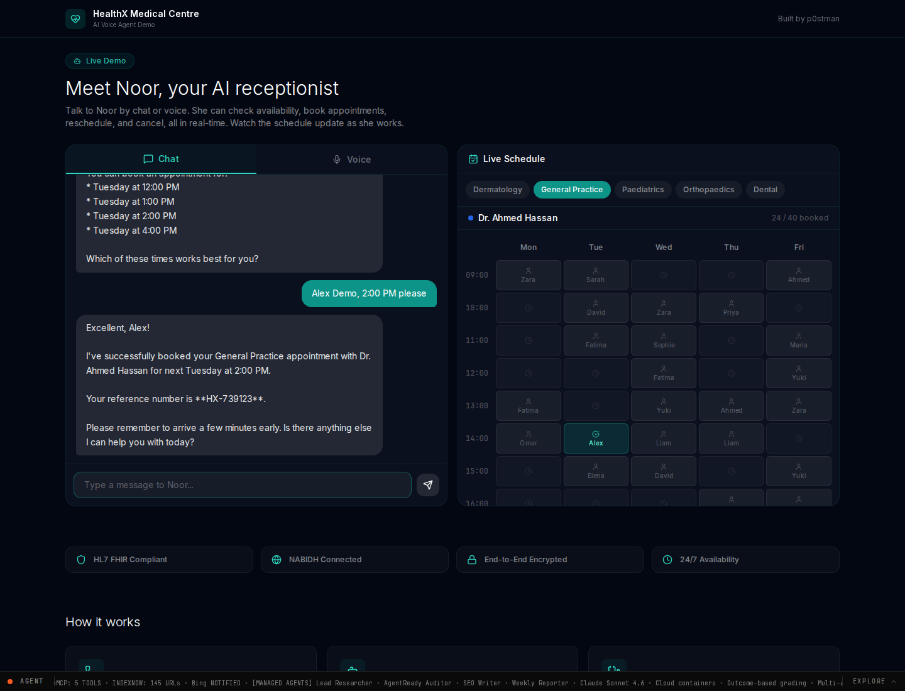
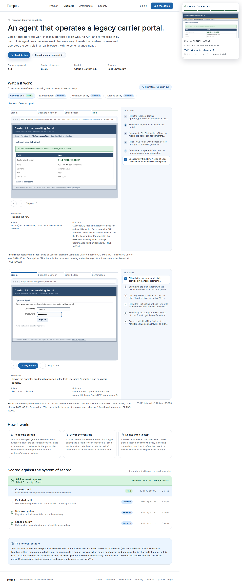

# Benchmark en vivo: gestión de citas vs gestión de reclamos

Probé productos que se pueden abrir hoy, sin login de cliente. Los videos son capturas reales de esas demos, no animaciones.

**Video completo (3 min):** [00-benchmark-citas-y-reclamos.mp4](videos/00-benchmark-citas-y-reclamos.mp4)

| Clip | Flujo | Duración | Link para probarlo vos |
| --- | --- | --- | --- |
| [01-citas-miadi.mp4](videos/01-citas-miadi.mp4) | Sacar y reprogramar un turno | 34 s | [miadi.care/demo](https://miadi.care/demo) |
| [01-citas-miadi-whatsapp.mp4](videos/01-citas-miadi-whatsapp.mp4) | El mismo flujo, recorte del teléfono | 34 s | idem |
| [02-citas-noor.mp4](videos/02-citas-noor.mp4) | Pedir turno y chequear agenda real | 79 s | [p0stman.com/demo/clinic-booking](https://www.p0stman.com/demo/clinic-booking) |
| [03-reclamos-tempo.mp4](videos/03-reclamos-tempo.mp4) | Presentar un FNOL en un portal legado | 57 s | [tempo-claims.com/operator](https://www.tempo-claims.com/operator) |

Datos de prueba: `Alex Demo`. Nada personal.

---

## Parte 1 — Gestión de citas

### Flujo 1: Miadi (Smile Dental demo)

Canal: WhatsApp embebido. Es el mismo asistente que pondría una clínica en su número.

1. Pedí un turno.
2. Dije que era para mí, un check-up.
3. Elegí hoy 14:30, nombre Alex Demo.
4. Me devolvió tarjeta de turno + referencia `W879YV`.
5. Pedí moverlo a las 12:00. Lo movió y conservó la misma referencia.

Transcripción real:

> Check-up & consultation, 30 min, USD 25. Traé DNI, credencial y radiografías. Caja y tarjetas. Horarios de hoy: 11:00, 12:00 o 14:30.
>
> You're all set, Alex. Booked for Tue 10 Nov, 2:30 PM. Ref: W879YV.
>
> Done, Alex. Moved to 12:00 PM. Same card, same ref.

La tarjeta pública quedó en [miadi.care/c/…](https://miadi.care/c/0Yh2u8D9Q1-8WCMZmbeCUqMn) (la demo la borra a las 24 h).



Lo que hace bien: cierra el caso dentro del chat. Precio, qué llevar, horario, tarjeta y reprogramación, sin menú. Si escribís algo urgente (“severe pain”) o pedís consejo médico, no diagnostica: pasa a staff.

Límite: todavía no se conecta a un EHR. Usa su propio calendario. Precio público desde USD 107/mes (Starter). No opera en EE. UU.

### Flujo 2: Noor (HealthX Medical Centre, demo de p0stman)

Canal: chat + agenda al lado, actualizándose en vivo.

Corrida que cerró el turno:

1. Pedí general practice para el martes a la tarde.
2. Ofreció slots de Dr. Ahmed Hassan: 12:00, 13:00, 14:00, 16:00.
3. “Alex Demo, 2:00 PM please”.
4. Confirmó el turno y dio referencia **HX-739123**.
5. El tablero pasó a General Practice y marcó **Alex** el martes a las 14:00.



En el video de este documento la agenda ya no tenía las 14:00. Noor no inventó el hueco: ofreció 15:00 y 16:00. Eso es exactamente lo que tiene que hacer un bot de turnos.

Lo que hace bien: el paciente ve el efecto en el calendario. Encaja doctor, especialidad y hueco en una sola conversación. Hay modo voz.

Límite: es una demo de producto (agencia / HIS), no un SaaS que instala una clínica en un día. En una corrida pedí reprogramar antes de confirmar y pidió el número de referencia: correcto, un poco rígido.

### Comparativa — citas

| Criterio | Miadi | Noor |
| --- | --- | --- |
| Se puede ver andando | Sí, demo pública | Sí, demo pública |
| Canal | WhatsApp (el que usa el paciente) | Chat / voz / (WhatsApp declarado) |
| Cierre del turno | Tarjeta + ref + link | Ref + slot pintado en la grilla |
| Reprogramar | Un mensaje, misma ref | Puede, si ya hay ref |
| Honestidad de agenda | Ofrece solo huecos reales | Ofrece solo huecos reales; rechazó 14:00 cuando no estaba |
| Integración clínica | Calendario propio, sin EHR todavía | Declara HL7 / FHIR / Epic / Cerner |
| Seguridad clínica | Nunca da consejo médico | Demo de recepción, no clínica |
| Para quién | Clínica chica / mediana, LATAM y resto salvo EE. UU. | Hospital o red que ya tiene HIS |

**Quién gana este flujo:** Miadi, si el objetivo es un producto que un dueño de consultorio puede prender mañana. Noor gana si el objetivo es mostrar operación de agenda de verdad, con doctor y tablero.

---

## Parte 2 — Gestión de reclamos

Acá el listón era el mismo: verlo andando, no reconstruirlo de un blog.

Probé Annie (Anycover): pide un Contract ID y, con el UUID de ejemplo, respondió “We're having trouble starting your claim”. El intake de Tempo está atrás de un código de demo. El webchat de Syllable está vivo (Jordan, Meridian Insurance), pero el iframe no dejó completar el alta desde acá.

Lo que sí corrí de punta a punta, en video, es el otro lado del reclamo: el agente que carga el FNOL en el sistema de la aseguradora.

### Flujo 3: Tempo Operator — First Notice of Loss

Demo pública: [tempo-claims.com/operator](https://www.tempo-claims.com/operator). Botón **Run "Covered peril" live**.

El agente abre un portal legado (CarrierLink), se loguea, entra a File First Notice of Loss, carga la pérdida y obtiene confirmación.

Resultado de la corrida grabada:

- Política `POL-4480-WC`
- Claimant Samantha Davis
- Peril: water (pipe burst)
- Confirmación **CL-FNOL-100092**
- 40 segundos. La página compara contra ~4 minutos de un humano.
- Costo medido de esa corrida: USD 0.09



Lo que hace bien: no es un chatbot que “te deriva”. Opera el sistema donde vive el reclamo. Si el siniestro está excluido, la póliza no existe o está vencida, no fuerza el alta: deriva. Eso está testeado en 4 escenarios (1 filed, 3 referred).

Límite: es B2B para claims ops, no la cara del asegurado. El chat de intake para el cliente está gated. Las cifras las publica Tempo.

### El par conversacional (para que lo pruebes vos)

**Syllable Insurance Claims Agent** — [syllable.ai/showcase/insurance-claims-agent](https://syllable.ai/showcase/insurance-claims-agent)

- Chat en el browser, teléfono `(650) 609-3870`, SMS `(650) 547-0832`.
- Identifica al asegurado antes de hablar del reclamo.
- Alta de reclamo auto/hogar, estado, documentos, y *warm transfer* a un humano si hay lesiones, culpa disputada o montos.
- No completa el caso solo: abre el record y le pasa el resto al equipo de claims.

Es el espejo de Tempo: Syllable habla con el cliente; Tempo trabaja el expediente.

### Comparativa — reclamos

| Criterio | Tempo Operator | Syllable Claims Agent |
| --- | --- | --- |
| Se puede ver andando | Sí: corrida live, video incluido | Sí: webchat / teléfono / SMS. No pude cerrar el alta desde el iframe |
| Quién inicia | El back office | El asegurado |
| Qué cierra | FNOL en el portal, con número de confirmación | Intake + número de reclamo (declarado); el juicio humano queda afuera |
| Guardrail | No fabrica cobertura; si está excluido, para | Identidad primero; no revela datos si falla el ID |
| Tiempo | 40 s vs ~4 min humano (dato del vendor, medido en esta corrida) | Call corto, el resto lo toma claims |
| Encaje | TPA / carrier con portal legado | Contact center de un carrier |

**Quién gana este flujo:** Tempo, para “el reclamo realmente entra al sistema”. Syllable, para “el cliente no espera en un 0800”. Un producto redondo necesita los dos lados.

---

## Hallazgos

1. **Citas ya están resueltas a nivel UX.** Miadi cierra turno + tarjeta + reprogramación en un hilo de WhatsApp. Cidi (San Juan) era el mismo patrón con DNI; Miadi le suma precio, qué llevar y un comprobante que se puede mostrar en recepción.
2. **La agenda tiene que ser real.** Noor se negó a inventar las 14:00. Eso vale más que un “listo, agendado” falso.
3. **En reclamos, el chatbot de cara al cliente no alcanza.** El salto es el agente que escribe en el core. Tempo lo muestra. Por eso Lemonade/Jim pegó: no charlaba del reclamo, lo pagaba.
4. **Ausentismo y FNOL incompleto son el mismo problema:** un hueco que se pierde. Recordatorio + reprogramación (Miadi) y FNOL en 40 s (Tempo) atacan cada uno.

## Qué copiar si armas algo en Argentina

- WhatsApp, no app nueva.
- Un flujo: sacar / confirmar / reprogramar / liberar el hueco.
- Comprobante con referencia, como la tarjeta de Miadi.
- Nunca consejo clínico.
- Si más adelante hay reclamos (prepaga, ART, seguro), el bot no puede ser solo menú: tiene que dejar un número de caso en el sistema, o no sirve para escalar.

## Cómo repetir las pruebas

```
Citas 1: https://miadi.care/demo
         “I'd like to book an appointment” → check-up → horario + nombre → reschedule

Citas 2: https://www.p0stman.com/demo/clinic-booking
         “general practice next Tuesday afternoon” → nombre + horario → Yes

Reclamos: https://www.tempo-claims.com/operator
          “Run Covered peril live”

Cara al cliente: https://syllable.ai/showcase/insurance-claims-agent
                 o llamar al (650) 609-3870
```
